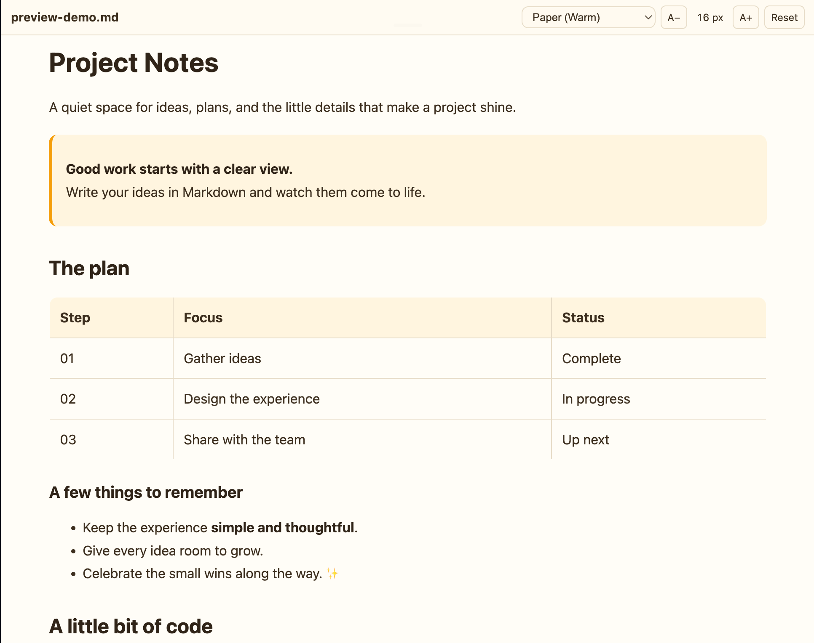
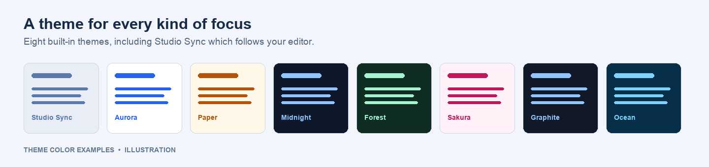

# Beautiful Markdown Preview

A polished Markdown preview for VS Code, with a choice of themes and text sizes that make reading more comfortable.



*Beautiful Markdown Preview in the Paper theme.*

## Made for reading

- **Preview as you write.** Open a side-by-side preview that updates as you edit. When the source editor is visible, scrolling either view keeps the other in sync.
- **Choose your look.** Pick from eight built-in themes. Studio Sync follows your editor's light or dark theme.
- **Set a comfortable size.** The preview follows the Markdown editor's font size by default. Use **A−** and **A+** to adjust it, or **Reset** to follow the editor again. Your custom size is remembered across preview panels and restarts.
- **See more than text.** Render Mermaid diagrams, highlighted code blocks, and local images alongside your Markdown.
- **Find your place.** Use document links to jump to headings, and the back-to-top button to return to the beginning.

## Themes



Choose **Studio Sync**, **Aurora**, **Paper**, **Midnight**, **Forest**, **Sakura**, **Graphite**, or **Ocean** from the preview toolbar.

## Getting started

1. Open a Markdown file (`.md` or `.markdown`).
2. Choose one of these ways to open the preview:
   - Click **Open Beautiful Preview** above the document or in the editor title bar.
   - Run **Beautiful Markdown Preview: Open Beautiful Preview** from the Command Palette.
   - Right-click a Markdown file in Explorer and choose **Open Beautiful Preview**.
   - Use **Open With… → Beautiful Preview** to open the file as a preview editor.
3. Move the pointer to the top of the preview to reveal the toolbar. Select a theme or use **A− / A+** to change the text size. Custom sizes range from 10 to 32 px in 1 px steps; **Reset** restores the editor setting.

## Local development

```bash
npm install
npm run compile
```

Press `F5` to launch an Extension Development Host. Theme colors, labels, and Mermaid theme mappings are defined in `src/theme-config.ts`.
