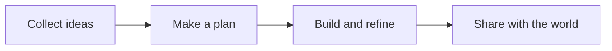

# Project Notes

A quiet space for ideas, plans, and the little details that make a project shine.

> **Good work starts with a clear view.**  
> Write your ideas in Markdown and watch them come to life.

## The plan

| Step | Focus | Status |
| :--- | :--- | :--- |
| 01 | Gather ideas | Complete |
| 02 | Design the experience | In progress |
| 03 | Share with the team | Up next |

### A few things to remember

- Keep the experience **simple and thoughtful**.
- Give every idea room to grow.
- Celebrate the small wins along the way. ✨

## A little bit of code

```typescript
function greet(name: string): string {
  return `Hello, ${name}! Ready to make something beautiful?`;
}

console.log(greet('world'));
```

## From idea to launch



---

Made with care, curiosity, and a good cup of coffee. ☕
